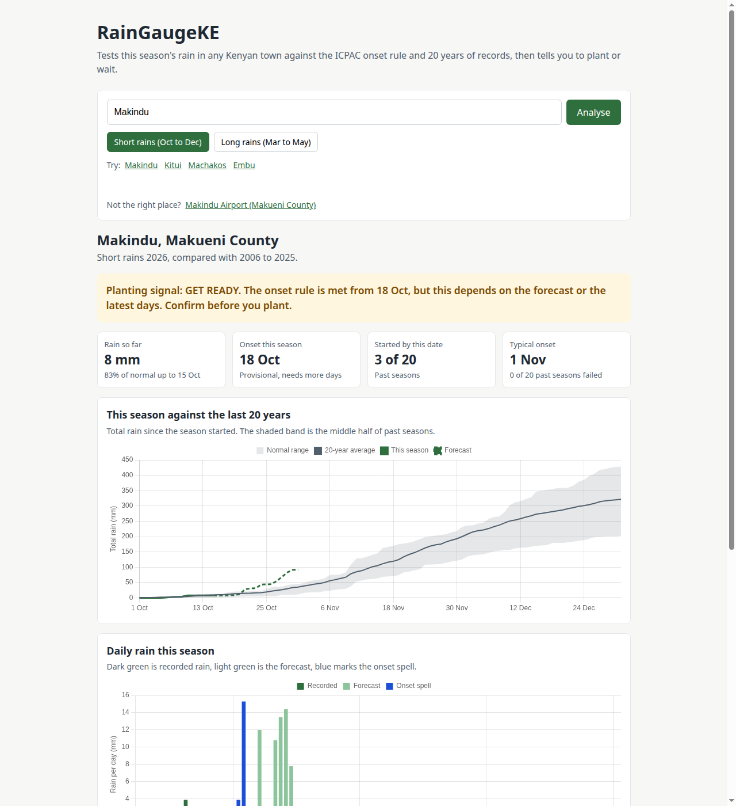
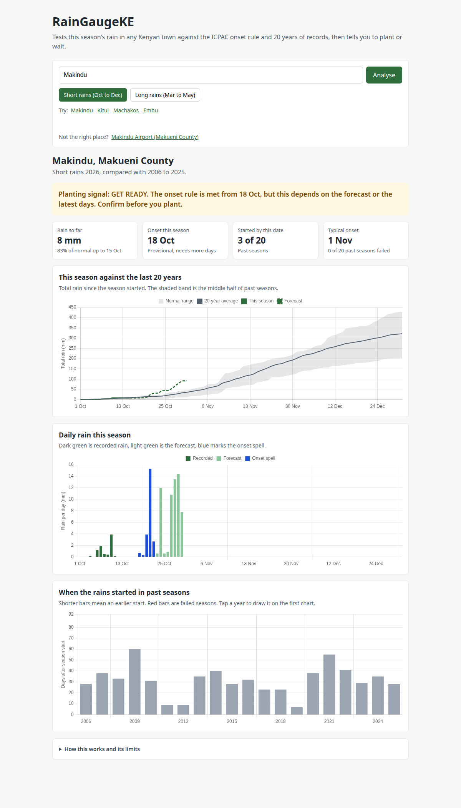
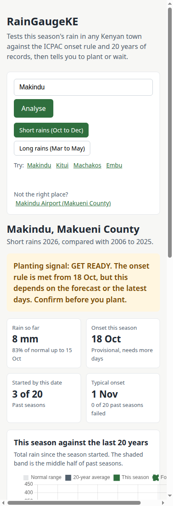

# RainGaugeKE

> **Have the rains really started?**  
> Tests this season's rain in any Kenyan town against the official ICPAC onset rule and 20 years of historical climate records to give farmers a clear **GO**, **GET READY**, or **WAIT** planting signal.

**Live Demo:** [https://mwaniasam.github.io/RainGaugeKE/](https://mwaniasam.github.io/RainGaugeKE/)

---

## Visual Overview & Screenshots

### Desktop Analysis Dashboard (Makindu)


### Complete Analysis & Historical Comparison Charts


### Mobile Responsive Interface
<p align="center">
  
</p>

---

## The Problem

Smallholder farmers in Kenya frequently plant after the first heavy showers. All too often, the rains stall immediately afterward, the newly sown seed dries up in the soil, and farmers are forced to buy and plant seed twice—or face crop failure.

The fundamental question farmers need answered is not simply *"Will it rain this week?"* but rather:
1. **Has the rainy season truly started?**
2. **Is this season normal compared to the past 20 years?**
3. **Should I plant now, get ready, or wait?**

---

## What It Does

Enter any town in Kenya (e.g., Makindu, Kitui, Machakos, Embu) and choose a season (**Short rains: Oct–Dec** or **Long rains: Mar–May**). RainGaugeKE then:

1. **Evaluates Onset Rule**: Tests current rainfall and the 16-day forecast against the official ICPAC meteorological definition for onset of rains.
2. **Benchmarks Against 20 Years**: Compares cumulative rain so far against the 20-year normal and interquartile range for the exact same calendar date.
3. **Historical Probability**: Calculates how many of the past 20 seasons had started by today's date and how many historical seasons failed completely.
4. **Actionable Planting Signal**: Issues an unambiguous status banner:
   - **GO** — Rains started and satisfied the full onset rule without subsequent dry spells.
   - **GET READY** — Onset criteria met, but relies partly on upcoming forecast days; prepare inputs and verify.
   - **WAIT** — Season has not met onset conditions, or rains are delayed compared to history.

### Three Interactive Charts
- **This Season Against the Last 20 Years**: Cumulative rainfall curve plotted against the 20-year average line and a shaded band representing the middle 50% (interquartile range) of historical seasons.
- **Daily Rain This Season**: Bar chart separating recorded rainfall (dark green), forecast rain (light green), and the 5-day onset spell (highlighted in blue).
- **When the Rains Started in Past Seasons**: Historical start dates across 20 seasons. Shorter bars indicate an early start; red bars highlight failed seasons. Clicking any bar superimposes that specific year onto the cumulative chart for instant comparison.

---

## The Onset Rule (ICPAC)

Adopted from the **IGAD Climate Prediction and Applications Centre (ICPAC)**:

$$\text{Onset} = \text{First day of a 5-day spell with} \ge 20\text{ mm rain and} \ge 3\text{ rain days } (\ge 1\text{ mm}),$$
$$\text{provided no dry spell} > 7\text{ consecutive days occurs within the following 21 days.}$$

- **Confirmed Onset**: The 5-day spell and all 21 follow-up days consist entirely of observed historical/recorded rain.
- **Provisional Onset**: The criteria are satisfied, but rely partially on the 16-day forecast or recent unconfirmed days.

---

## Data Sources & Architecture

RainGaugeKE is built completely keyless and runs 100% client-side without a backend server or `.env` file:

| Data Layer | API Endpoint | Authentication | Description |
| :--- | :--- | :---: | :--- |
| **Town Geocoding** | [Open-Meteo Geocoding API](https://open-meteo.com/en/docs/geocoding-api) | None (Public) | Resolves town names to Kenyan coordinates (`countryCode=KE`). |
| **20-Year Climate History** | [Open-Meteo Historical Weather API](https://open-meteo.com/en/docs/historical-weather-api) | None (Public) | Daily ERA5 reanalysis precipitation for 20 preceding seasons. |
| **Current Season & Forecast** | [Open-Meteo Forecast API](https://open-meteo.com/en/docs) | None (Public) | Observed precipitation to date plus seamless 16-day forecast. |

---

## Setup & Local Usage

### Quick Start
Clone the repository and navigate to the project directory:

```bash
git clone https://github.com/mwaniasam/AI-masterclass2.git
cd AI-masterclass2/week-1/project
```

Double-click `index.html` or open it with your browser:
```bash
xdg-open index.html  # On Linux
open index.html      # On macOS
start index.html     # On Windows
```

### Local HTTP Server (Recommended for Shareable Links)
To support deep links and browser history state (e.g. `?town=Makindu&season=short`), serve the directory locally:

```bash
# From AI-masterclass2/week-1/project:
python3 -m http.server 8000
```

Open [http://localhost:8000](http://localhost:8000) or test deep links directly:
- [http://localhost:8000/?town=Makindu&season=short](http://localhost:8000/?town=Makindu&season=short)
- [http://localhost:8000/?town=Kitui&season=short](http://localhost:8000/?town=Kitui&season=short)
- [http://localhost:8000/?town=Machakos&season=short](http://localhost:8000/?town=Machakos&season=short)

---

## Comprehensive Error Handling

RainGaugeKE anticipates every real-world edge case:

| Scenario | UI State & Behavior |
| :--- | :--- |
| **Town Not Found** | Displays: *"\"Xyzabc\" was not found in Kenya. Check the spelling or try a nearby larger town."* |
| **Short Query** | Validates length: *"Enter at least 2 letters of a town name."* |
| **No Internet Connection** | Traps network error: *"Could not connect. Check your internet connection and try again."* |
| **Slow API Timeout** | AbortController aborts after 20s: *"The weather service took too long to respond. Try again."* |
| **Rate Limited (HTTP 429)** | Gracefully informs: *"Too many requests to the weather service. Wait a minute and try again."* |
| **Upstream API Error** | Displays sanitized upstream error reason while keeping UI intact. |
| **Unexpected JSON Structure** | Validates schema: *"The weather service sent data in an unexpected format."* |
| **Missing Past Season Data** | Automatically skips incomplete years and reports count (e.g. *"(1 year skipped for missing data)"*). |
| **Insufficient Records** | Refuses misleading comparisons if fewer than 10 historical seasons are available. |
| **CDN / Chart.js Failure** | If Chart.js fails to load, text statistics and verdict still render with a fallback notification. |
| **Rapid Successive Searches** | Request count IDs prevent race conditions so only the latest search renders. |

---

## Limitations

- **Gridded Reanalysis vs. Ground Gauge**: ERA5 data is gridded at ~9 km to 25 km resolution. Hyper-local convective showers on a specific ridge or farm may differ from grid-cell averages.
- **Bimodal Season Fit**: The fixed seasons (March–May Long Rains, October–December Short Rains) accurately fit central, eastern, and coastal Kenya. Western Kenya and parts of the Rift Valley have a unimodal rainfall regime.
- **Model Transition**: Historical baselines use ERA5 reanalysis, while the current season bridges observed ECMWF data with forecast runs.
- **Decision Aid Only**: This tool provides probabilistic meteorological insights based on ICPAC standards and does not replace tailored agronomic or soil-specific recommendations.

---

## Built With

- **HTML5 & Semantic CSS3**: Clean, lightweight, responsive mobile-first interface.
- **Vanilla JavaScript (ES6+)**: `async/await`, Fetch API with `AbortController`, Array statistical functions (`percentile`, `runningTotal`, `mean`).
- **[Chart.js 4.4](https://www.chartjs.org/)**: Canvas-based interactive charts with custom tooltips, click-to-compare interactions, and responsive scaling.
- **No external build tools or dependencies**: Pure zero-configuration frontend.

---

## Author

**Samuel Mwania**  
GitHub: [@mwaniasam](https://github.com/mwaniasam)  
Repository: [https://github.com/mwaniasam/AI-masterclass2/tree/main/week-1/project](https://github.com/mwaniasam/AI-masterclass2/tree/main/week-1/project)
